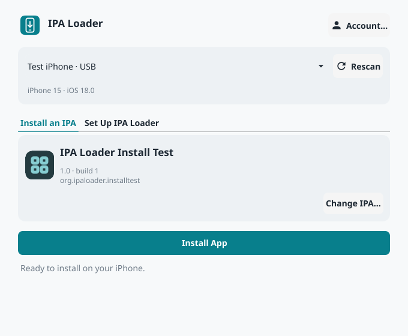
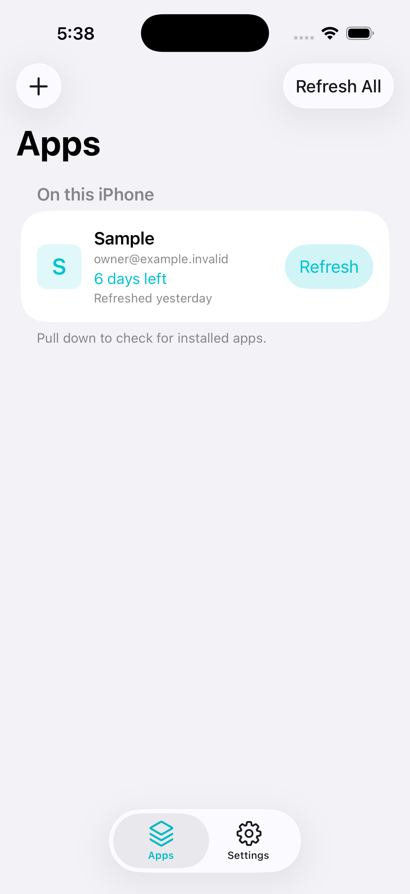
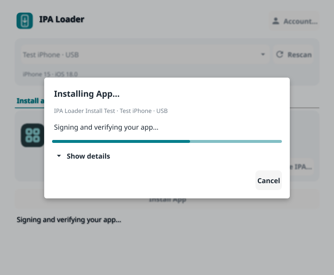
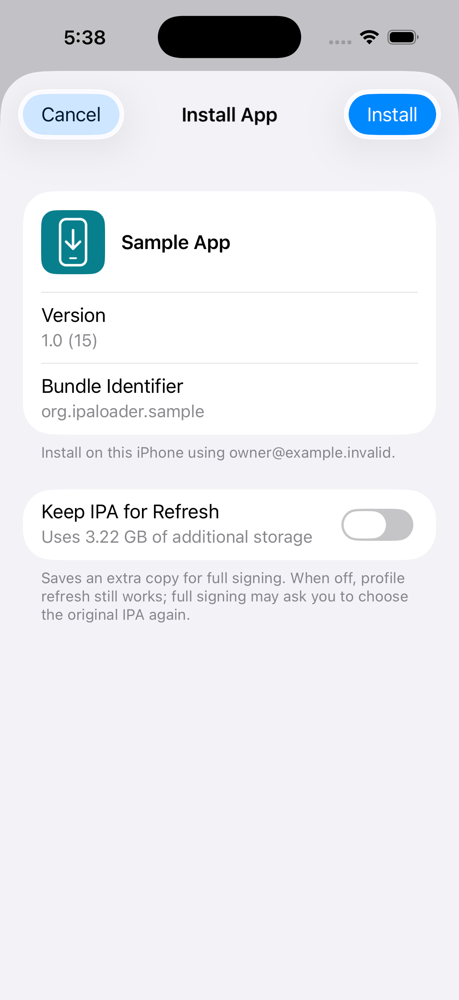

# IPA Loader

Self-contained IPA loading for Desktop and iPhone. Sideload your apps from macOS, Windows, Linux or the iPhone itself, with no external servers needed!

- 🍎 macOS 15+
- 🪟 Windows 10/11 (64-bit) — install iTunes for the Apple USB device drivers.
- 🐧 Linux (64-bit) — install `usbmuxd`, `libsecret`/GLib, and a desktop Secret Service such as GNOME Keyring.
- 📱 iOS 15+ — install and refresh apps from your phone after desktop setup.

Install the latest from [releases](https://github.com/acheronfail/ipa-loader/releases).

Free Apple developer accounts need `IPA-Loader-Free-Accounts.ipa` and [LocalDevVPN](https://apps.apple.com/app/id6755608044); paid accounts can use `IPA-Loader-Paid-Accounts.ipa`, which includes its own local VPN. The desktop app bundles both and automatically picks the right one during setup.

## Screenshots

| Desktop | iPhone |
| --- | --- |
|  |  |
|  |  |

## Credits

Thanks to the projects and communities whose work informed IPA Loader:

- [AltStore](https://github.com/altstoreio/AltStore) and [AltSign](https://github.com/rileytestut/AltSign) — references for Apple authentication, provisioning and signing workflows.
- [Sideloadly](https://sideloadly.io/) — a reference for signing, installation and bundle identity behavior.
- [SideStore](https://github.com/SideStore/SideStore) — on-device sideloading and refresh work.
- [Impactor](https://github.com/claration/impactor) — cross-platform sideloading and provisioning references.
- [xtool](https://github.com/xtool-org/xtool) — cross-platform iOS tooling and authentication metadata references.
- [Provision](https://github.com/Dadoum/Provision) and [anisette-v3-server](https://github.com/Dadoum/anisette-v3-server) — anisette provisioning protocol references.
- [libimobiledevice](https://libimobiledevice.org/) — device-service protocol implementations and documentation.
- [zsign](https://github.com/zhlynn/zsign) — signing references and public certificate-chain material.
- [fishhook](https://github.com/facebook/fishhook) — symbol rebinding used by the sharing compatibility adapter.

Dependency licenses and attribution are included in application releases.
